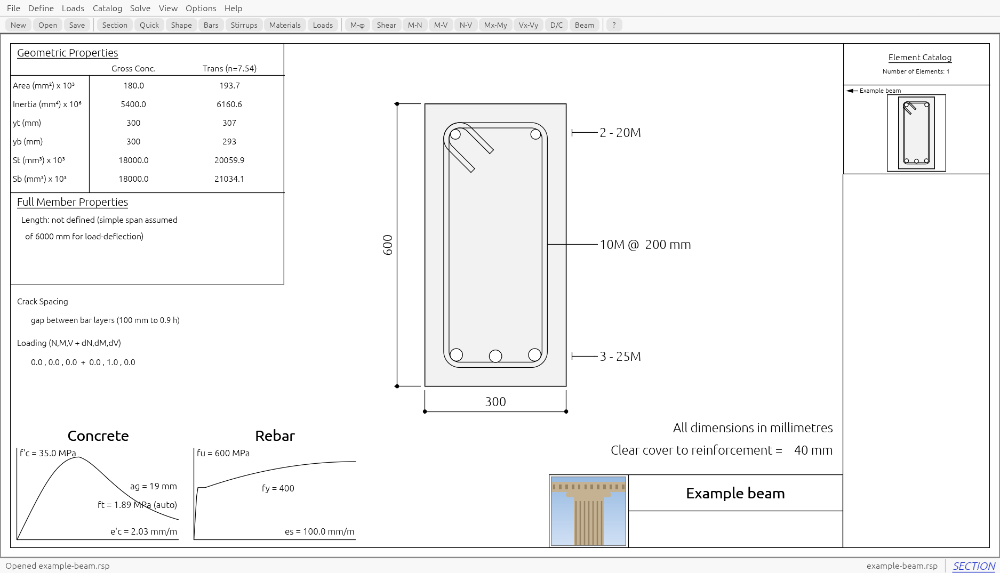
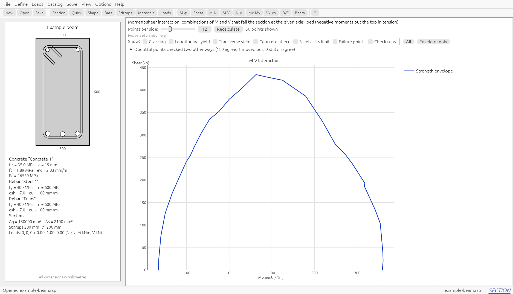

# Section Response

Sectional analysis of reinforced and prestressed concrete members using the Modified
Compression Field Theory (in the manner of Response-2000). A desktop app for Windows and Linux,
written in Rust.

## Get it

- **Download:** the latest build from
  [Releases](https://github.com/randomcrit2020/r2k-rs/releases). There is no installer.
  - Windows: `section-response-…-windows-x64.zip` — unzip it and run `section-response.exe`.
  - Linux: `section-response-…-linux-x64.tar.gz` — unpack it and run `./section-response`
    (x86-64, glibc 2.28 or newer).
- **Build from source** (Rust stable; the MSVC toolchain on Windows):

  ```powershell
  cd app
  cargo run --release
  ```

## Example: M-V interaction of a rectangular beam

A 300 × 600 mm beam with ordinary reinforcement and no prestressing:

| | |
|---|---|
| Concrete | f'c = 35 MPa |
| Steel | fy = 400 MPa (bars and stirrups) |
| Top bars | 2 × 20M |
| Bottom bars | 3 × 25M |
| Stirrups | closed 10M @ 200 mm |
| Clear cover | 40 mm |

### 1. Define the section

Use **Define > Quick Define...**, choose a rectangle and enter the values above. Or open the
ready-made file [`docs/example-beam.rsp`](docs/example-beam.rsp) with **File > Open...**.

The section screen shows the cross-section, its properties and the material curves:



### 2. Solve the M-V interaction

Use **Solve > M-V Interaction**, or the **M-V** button on the toolbar. Each point on the curve
is a full analysis to failure, with moment and shear rising together at a fixed ratio.
Negative moments put the top in tension.



- By default only the strength envelope is drawn. The **Show:** checkboxes add the cracking,
  yield and strain-limit curves, the design curve and the failure points.
- Hover over or touch a line to read its values: exact on a computed point, interpolated
  between points. Click or tap to pin the readout.

For this beam the moment capacity with no shear is 359 kNm in sagging and 165 kNm in hogging,
and the highest shear on the envelope is 434 kN (at M = 63 kNm).

The same analysis from the command line:

```powershell
section-response.exe --solve interaction docs\example-beam.rsp
```

## More

- [app/MCP.md](app/MCP.md): run the program as an MCP server for AI assistants.
- [app/MECHANICS.md](app/MECHANICS.md): the mechanics behind the analyses.

## License

[MIT](LICENSE)
